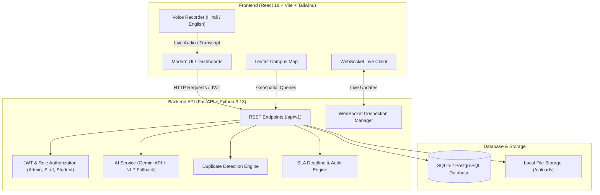

# 🎓 CampusFix AI - A Smarter Campus. A Faster Solution.

[](https://fastapi.tiangolo.com)
[](https://react.dev)
[](https://tailwindcss.com)
[](https://deepmind.google/technologies/gemini/)
[](https://pytest.org)

An enterprise-grade, AI-powered campus facility and complaint management platform connecting **Students**, **University Departments & Maintenance Technicians**, and **Central Administration** in real time.

---

## 🚀 Key Innovations & Features

1. **Multimodal Reporting (Text, Image & Voice in Hindi/English)**
   - Native Web Speech API integration supporting live English and Hindi speech-to-text.
   - Camera & photo drag-and-drop file uploads with static serving and validation.
2. **Gemini AI Complaint Analysis & Automated Triage**
   - Automatic classification into 8 categories: *Electrical, Plumbing, Housekeeping, Internet and IT, Civil Maintenance, Furniture, Security, and Other*.
   - Smart priority classification (*Critical, High, Medium, Low*) based on safety risks and campus disruption.
   - **Critical Safety Escalation**: Identifies fire hazards, live sparks, and structural failure with immediate human escalation alerts.
   - **Dual-Mode AI Engine**: Seamlessly calls Google Gemini API when `GEMINI_API_KEY` is present; operates with high precision using an offline rule-based NLP classifier if absent.
3. **Duplicate Complaint Prevention Engine**
   - Cross-references tokenized text similarity (Jaccard + SequenceMatcher), campus building blocks, categories, and time windows.
   - Alerts students with interactive matching modals before filing duplicate tickets.
4. **Interactive Geospatial Campus Map**
   - Built on Leaflet and OpenStreetMap.
   - Color-coded severity pins, building boundary circles, popups with live statuses, and admin filtering by category, priority, and status.
5. **Dynamic SLA Tracking & Violation Monitor**
   - Automated SLA deadlines (4h for Critical, 24h for High, 48h for Medium, 72h for Low).
   - Real-time SLA breach detection and administrative compliance scoring.
6. **Live Real-Time WebSockets**
   - Live push updates across user sessions for new complaints and technician status changes.
7. **Resolution Verification & Feedback Rating**
   - Staff technicians upload resolution photos and completion notes.
   - Students verify repairs and submit 1–5 star ratings with feedback.
8. **Executive Command Center & CSV Export**
   - Comprehensive interactive charts (Recharts) for category distribution and monthly trends.
   - One-click export of campus reports as CSV or JSON.

---

## 📐 System Architecture



---

## 👥 User Roles & Permissions

| Role | Access Scope | Key Capabilities |
| :--- | :--- | :--- |
| **Student** | Student Portal | Register, file text/image/voice complaints, preview AI triage, inspect ticket timeline, reopen unresolved issues, provide 1-5 star ratings. |
| **Department Staff** | Staff Portal | View department work orders, accept tickets, update status to In Progress / Resolved, upload resolution photos and technician notes, monitor department SLA. |
| **Administrator** | Command Center | Campus-wide overview, view all complaints, assign tickets to staff, manage buildings with GPS coordinates, manage departments, manage users, view analytics, export CSV/PDF. |

---

## 🔑 One-Click Demo Credentials (Pre-Seeded)

The application includes pre-seeded demo accounts. You can also use the **Demo Switcher** buttons in the navigation bar or login page:

| Role | Email | Password | Assigned Area |
| :--- | :--- | :--- | :--- |
| **Administrator** | `admin@campusfix.edu` | `Admin@123` | Central Administration |
| **Staff (Electrical Lead)** | `electrical.staff@campusfix.edu` | `Staff@123` | Electrical Maintenance |
| **Staff (IT Network Lead)** | `it.staff@campusfix.edu` | `Staff@123` | IT & Campus Network |
| **Staff (Plumbing Lead)** | `plumbing.staff@campusfix.edu` | `Staff@123` | Plumbing & Water Works |
| **Student 1** | `arjun.sharma@student.campusfix.edu` | `Student@123` | Student |
| **Student 2** | `priya.verma@student.campusfix.edu` | `Student@123` | Student |

---

## ⚡ Quick Start & Execution

### 1. Backend Setup

```bash
# Navigate to backend directory
cd backend

# Create and activate virtual environment
python -m venv venv
# Windows:
venv\Scripts\activate
# Linux/macOS:
source venv/bin/activate

# Install dependencies
pip install -r requirements.txt

# (Optional) Set your Gemini API key in .env or environment
# export GEMINI_API_KEY="your-gemini-key"

# Run backend server
uvicorn app.main:app --reload --port 8000
```
*The backend automatically creates all SQLite tables and seeds the database with realistic demo buildings, departments, users, and complaints on first launch.*

API Documentation (Swagger UI): `http://127.0.0.1:8000/docs`

### 2. Frontend Setup

```bash
# Navigate to frontend directory
cd frontend

# Install node dependencies
npm install

# Run Vite development server
npm run dev
```

Frontend application will be live at: `http://localhost:5173`

---

## 🧪 Automated Testing

Backend test suite with Pytest covers auth, role-based authorization, AI categorization, duplicate text similarity, building endpoints, and ticket creation:

```bash
cd backend
venv\Scripts\pytest tests
```

---

## 📦 Docker Deployment

Run both the frontend and backend using Docker Compose:

```bash
docker-compose up --build
```
- Frontend: `http://localhost:5173`
- Backend API: `http://localhost:8000`
